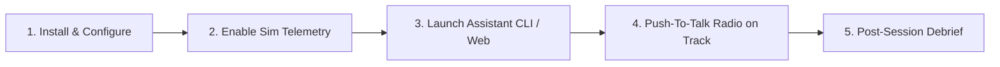

# User Onboarding & Connection Guide 🏎️📡

This guide explains how a user sets up, connects their game/sim telemetry, configures their voice input, and initiates their virtual race engineer session with **PitwallKing**.

---

## 🏁 High-Level User Flow



---

## Step 1: Clone & Configure

### 1.1 Clone the Repository
```bash
git clone https://github.com/lalit-rg/ApexAI-F1RaceEngineer.git
cd ApexAI-F1RaceEngineer
```

### 1.2 Setup Environment Config
Create a `.env` file in the project root:
```env
# Optional: Only needed for Tier-3 deep strategic LLM reasoning
GEMINI_API_KEY=your_gemini_api_key_here
# or
OPENAI_API_KEY=your_openai_api_key_here

# Default Sim Engine: f1_ea | ac_acc | iracing
ACTIVE_SIM=f1_ea

# Default Persona Profile (from persona catalog)
# Options: gp_direct, bono_calm, alonso_tactician, vettel_analyst, prost_minimal, steiner_banter, telemetry_nerd, ferrari_drama, hype_spotter, kimi_minimal
DEFAULT_PERSONA=gp_direct

# Radio Push-To-Talk Wheel Button Binding (or keyboard key)
PTT_KEY=space
```

---

## Step 2: Enable Game Telemetry (One-Time Setup)

Depending on the game you play, enable telemetry broadcasting in your in-game settings:

### Option A: EA Sports F1 (F1 23 / 24 / 25)
1. In the game main menu, navigate to **Settings** $\rightarrow$ **Telemetry Settings**.
2. Set the following options:
   * **UDP Telemetry:** `On`
   * **UDP IP Address:** `127.0.0.1` (or your PC local IP if playing on PS5/Xbox)
   * **UDP Port:** `20777`
   * **UDP Send Rate:** `60Hz`
   * **UDP Format:** `2024` or `2025`
3. *(Optional for wheel button)*: Under **Controls** $\rightarrow$ **UDP Action 1**, bind your preferred steering wheel button to trigger the radio.

### Option B: Assetto Corsa & Assetto Corsa Competizione (ACC)
* **Zero Configuration Required!** 
* The engine uses Windows Shared Memory (`acpmf_physics` and `acpmf_graphics`), which ACC broadcasts natively whenever you leave the pit box.

### Option C: iRacing
1. In `Documents/iRacing/app.ini`, ensure memory broadcasting is active:
   ```ini
   [Telemetry]
   writeDisk=0          # Memory MMF streaming is enabled automatically by the iRacing SDK
   ```

---

## Step 3: Launching PitwallKing

Start the assistant via the command line:

```bash
python main.py
```

You will see the initialization status:
```text
================================================================================
 PITWALLKING: MULTI-SIM RACECRAFT & INFERENCE ASSISTANT
================================================================================
[Adapter] Ingestion connected to EA Sports F1 UDP Port 20777 (60Hz)
[Engine] Tier-1 In-Memory Buffer: ACTIVE (<0.5ms)
[Racecraft] Dynamic Strategy & Stewards Rule Engine: READY
[Persona] Active Race Engineer: Gianpiero Lambiase (The Commander)
[Radio] Push-To-Talk listening on Wheel Action 1 / [SPACE]...
```

---

## Step 4: Driving & Radio Interaction

Once you are on track, the system operates in two synchronized modes:

### 1. Passive / Rolling Prescriptive Alerts (1Hz Background Sweep)
You don't need to ask anything—the engine monitors your telemetry in the background. It only speaks via an **Interrupt Priority Queue** when critical thresholds breach:
* **Impending Overheating:** *"Rears at 126°C. Brake bias +2% forward, manage traction."*
* **Safety Car Window:** *"Safety Car deployed! Box box now for Softs, 12s cheap delta."*
* **Stewards Order:** *"Give the position back before Turn 4 to avoid a 5-second penalty."*
* **Track Limits Warning:** *"Black and white flag for track limits. Next strike is 5 seconds."*

### 2. On-Demand Driver Queries (Push-To-Talk)
Press your bound steering wheel button (or `Space`) and speak or query:

| What you ask | Engine Tier | Response Speed | Example Output |
|---|---|---|---|
| *"Radio check"* / *"Status"* | **Tier 1 (Instant)** | $< 0.5\text{ms}$ | *"P4, Lap 15. All systems green. Head down."* |
| *"What's the gap ahead?"* | **Tier 1 (Instant)** | $< 0.4\text{ms}$ | *"Gap to Norris is 1.2s."* |
| *"Tyre temps and wear check"* | **Tier 1 (Instant)** | $< 0.4\text{ms}$ | *"Tyres are at 34% wear. In optimal window."* |
| *"Can I push now?"* | **Tier 2 (Local SLM)**| $\sim 90\text{ms}$ | *"Max has 22-lap hards, bleed his tow into T1!"* |
| *"Safety Car! Do we box?"* | **Tier 3 (Cloud)** | Masked $<30\text{ms}$ | **(0ms):** *"Copy, checking with pit wall..."*<br>**(600ms):** *"Box box for Softs, clean air slot ahead of Hulkenberg."* |

---

## Step 5: Post-Session Debrief & Telemetry Review

When you take the checkered flag and return to the paddock, the system automatically transitions into post-session synthesis:

1. **Celebratory or Consoling Radio Transmission:**
   * **Win:** *"Get in there! Masterfully managed stint!"*
   * **Tough Race:** *"P8. Tough race in traffic, but points collected."*
2. **FastF1-Style Automated Performance Summary:**
   * Apex speed consistency score.
   * Total lap time lost trapped in dirty air wake.
   * Tyre degradation trajectory vs. the rest of the grid.
   * Braking marker depth envelope.
