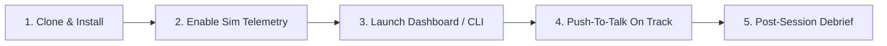

# PaddockPal — User Guide 🏎️📡

> **"Choose your pal before you go flying."**  
> This guide takes you from a fresh clone to a live pit-wall session in under 10 minutes.

---

## 🏁 High-Level User Flow



---

## Step 1: Clone & Install

### 1.1 Clone the Repository
```bash
git clone https://github.com/lalit-rg/PaddockPal.git
cd PaddockPal
```

### 1.2 Set Up Isolated Environment with `uv`
We use [uv](https://github.com/astral-sh/uv) — no global pip installs, no dependency bleed:
```bash
# Install uv (if not already installed)
pip install uv

# Create virtual environment and install PaddockPal + all deps
uv venv
uv pip install -e .
```

For dev tooling (ruff, pytest, pre-commit):
```bash
uv pip install -e ".[dev]"
```

### 1.3 Configure Your API Key (Optional — Only for Tier-3 Cloud LLM)
Create a `.env` file in the project root. **Everything works offline without this.**
```env
# Optional: Enables Tier-3 deep strategic reasoning (Safety Car decisions, Plan B/C)
GEMINI_API_KEY=your_gemini_api_key_here
# or
OPENAI_API_KEY=your_openai_api_key_here

# Default Sim Engine: f1_ea | ac_acc | iracing
ACTIVE_SIM=f1_ea

# Default Persona (see persona catalog for all options)
# gp_direct | bono_calm | alonso_tactician | vettel_analyst | prost_minimal
# steiner_banter | telemetry_nerd | ferrari_drama | hype_spotter | kimi_minimal
DEFAULT_PERSONA=gp_direct

# Push-To-Talk keyboard binding (when not using wheel button)
PTT_KEY=space
```

> **Tier 1 and Tier 2 are fully offline.** Tier 3 cloud LLM is opt-in and only activates for
> complex strategy calls (Safety Car, pit window simulation, Plan B vs C).

---

## Step 2: Enable Game Telemetry (One-Time Setup)

PaddockPal ingests telemetry from any supported sim. Enable broadcasting once in your game settings — the adapter auto-detects it.

### Option A — EA Sports F1 (F1 23 / F1 24 / F1 25)

**Playing on PC:**
1. Main Menu → **Settings** → **Telemetry Settings**
2. Set:
   - **UDP Telemetry:** `On`
   - **UDP IP Address:** `127.0.0.1`
   - **UDP Port:** `20777`
   - **UDP Send Rate:** `60Hz`
   - **UDP Format:** `2024` or `2025`

**Playing on PS5 / Xbox (LAN mode):**
1. Launch PaddockPal first — it will auto-detect and display your PC's LAN IP in the dashboard.
2. In the game: **Settings** → **Telemetry Settings**
   - **UDP IP Address:** *(use the IP shown on the PaddockPal dashboard, e.g. `192.168.1.105`)*
   - **UDP Port:** `20777`
   - **UDP Send Rate:** `60Hz`

> The dashboard's **🔌 CONNECT GAME / PS5** button shows the exact IP your console needs.

### Option B — Assetto Corsa & Assetto Corsa Competizione (ACC)

**Zero configuration required.** ACC broadcasts via Windows Shared Memory (`acpmf_physics`, `acpmf_graphics`) automatically when you leave the pit box. The `AssettoCorsaAdapter` reads it directly via `ctypes`.

### Option C — iRacing

iRacing's SDK uses memory-mapped files. No configuration needed in most setups. To verify:
```ini
# Documents/iRacing/app.ini
[Telemetry]
writeDisk=0   # Memory MMF streaming is on by default via the iRacing SDK
```

### Option D — Professional Telemetry (MoTeC i2 / McLaren ATLAS)

Export a live CSV stream from your MoTeC session. Set the file path in your `.env`:
```env
MOTEC_CSV_PATH=/path/to/your/live_export.csv
```

---

## Step 3: Launch PaddockPal

### Web Dashboard (Recommended)

```bash
.venv\Scripts\python ui\server.py          # Windows
# or
.venv/bin/python ui/server.py              # macOS / Linux
```

Open **`http://127.0.0.1:5000`** in your browser.

You'll see:
- **Live telemetry HUD** — Position, gaps, tyre temps, ERS, fuel delta
- **Persona selector** — Switch your race engineer mid-session
- **Team Radio panel** — Push-To-Talk query interface with quick buttons
- **🔌 CONNECT GAME / PS5** — Detects your LAN IP for console setup
- **🏁 POST-RACE DEBRIEF** — FastF1-style speed trace and session summary

### CLI Mode

```bash
.venv\Scripts\python main.py
```

Initialization output:
```
================================================================================
 PADDOCKPAL: MULTI-SIM RACECRAFT & INFERENCE ASSISTANT
================================================================================
[Adapter] Ingestion connected to EA Sports F1 UDP Port 20777 (60Hz)
[Engine]  Tier-1 In-Memory Buffer: ACTIVE (<0.5ms)
[Racecraft] Dynamic Strategy & Stewards Rule Engine: READY
[Persona]  Active Race Engineer: Gianpiero Lambiase (The Commander)
[Radio]    Push-To-Talk listening on Wheel Action 1 / [SPACE]...
```

---

## Step 4: Driving & Radio Interaction

### Passive Alerts (Automatic — No Input Needed)

The engine monitors telemetry in the background at 1Hz. It fires alerts only when critical thresholds breach:

| Condition | Alert |
|---|---|
| Rear tyre temps > 125°C | *"Rears critical at 126°C. Lift and coast 50m before braking."* |
| Safety Car deployed | *"Box box now! Softs. 12s cheap delta."* |
| FIA penalty risk | *"Give the position back before Turn 4 to avoid a 5-second penalty."* |
| Track limits warning | *"Black and white flag. Next strike is 5 seconds."* |

### Push-To-Talk Queries (On Demand)

Press your wheel button or `Space` and ask:

| Query | Tier | Latency | Example Response |
|---|---|---|---|
| *"Radio check"* / *"Status"* | **Tier 1** | < 0.5ms | *"P4, Lap 15. All systems green. Head down."* |
| *"What's the gap ahead?"* | **Tier 1** | < 0.4ms | *"Gap to Norris is 1.2s."* |
| *"Tyre temps and wear"* | **Tier 1** | < 0.4ms | *"Tyres at 34% wear. In optimal window."* |
| *"Can I push now?"* | **Tier 2** | ~90ms | *"Max has 22-lap hards. Bleed his tow into T1!"* |
| *"Safety Car! Do we box?"* | **Tier 3** | 0ms ack + 600ms deep | *"Copy, stand by..."* → *"Box box for Softs, clean air ahead of Hulkenberg."* |

---

## Step 5: Post-Session Debrief

Click **🏁 POST-RACE DEBRIEF** in the dashboard or it triggers automatically at session end.

The debrief engine delivers:

1. **Celebratory or Consoling Radio Transmission** (persona-authentic):
   - Win: *"Get in there! Masterfully managed stint!"* (GP / Lambiase)
   - Tough race: *"P8. Points collected. We analyse and come back stronger."*

2. **FastF1-Style Automated Performance Report:**
   - Braking consistency score (% within 5m marker envelope)
   - Total lap time lost trapped in dirty air
   - Tyre degradation trajectory vs. session reference pace
   - Speed trace overlay: your lap vs. fastest lap (canvas visualization)

---

## Choosing Your Pal

| Pal | Based On | Personality |
|---|---|---|
| **The Commander** `gp_direct` | Gianpiero Lambiase | Aggressive, direct, tactical |
| **The Anchor** `bono_calm` | Peter Bonnington | Calm, composed, precise |
| **The Shark** `alonso_tactician` | Fernando Alonso | Opportunistic, predatory |
| **The Professor** `vettel_analyst` | Sebastian Vettel | Mathematical, strategic |
| **The Minimalist** `prost_minimal` | Alain Prost | Efficient, zero excess |
| **The Realist** `steiner_banter` | Guenther Steiner | Brutally honest, entertaining |
| **The Aerodynamicist** `telemetry_nerd` | Adrian Newey style | Vehicle dynamics deep-dive |
| **Ferrari Drama** `ferrari_drama` | Ferrari Pit Wall | Chaotic, multi-plan, dramatic |
| **The Spotter** `hype_spotter` | NASCAR/IndyCar Spotter | High-energy, momentum coach |
| **The Ice Man** `kimi_minimal` | Kimi Räikkönen | ≤8 words, zero tolerance |

Switch pal at any time from the persona dropdown — the radio channel transition is instant.

---

## Troubleshooting

| Problem | Fix |
|---|---|
| No telemetry data appearing | Check UDP port 20777 is not blocked by Windows Firewall. Run `netstat -an \| findstr 20777`. |
| PS5 can't reach PC IP | Ensure both devices are on the same LAN subnet. Disable any AP isolation on your router. |
| `ModuleNotFoundError` on launch | Run from the project root using `.venv\Scripts\python`, not global `python`. |
| Tier-3 LLM not responding | Check `GEMINI_API_KEY` or `OPENAI_API_KEY` is set in `.env`. Tier 1 and 2 work offline regardless. |
| Dashboard shows `TemplateNotFound` | Always launch `ui/server.py` from the **project root**, not from inside `ui/`. |

---

## Where to Get Help

- **Issues:** [github.com/lalit-rg/PaddockPal/issues](https://github.com/lalit-rg/PaddockPal/issues)
- **LinkedIn:** [@lalit-rg](https://www.linkedin.com/in/lalit-rg/)
- **Contributing:** See [CONTRIBUTING.md](../CONTRIBUTING.md) for dev setup, pre-commit hooks, and PR rules.
